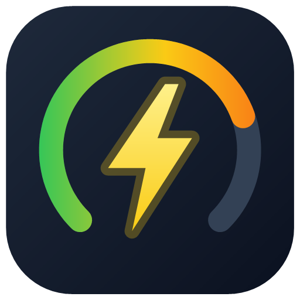
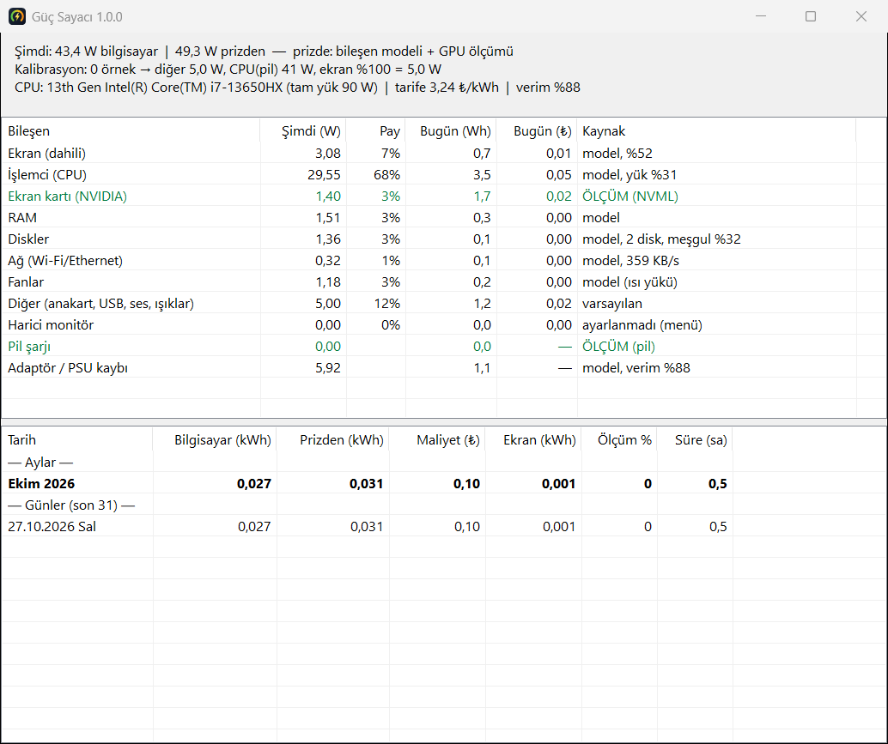

<div align="center">



# Güç Sayacı

**Bilgisayarınız bugün ne kadar elektrik harcadı ve bu size kaça mal oldu?**<br>
Windows için arka planda sessizce çalışan, neredeyse hiç kaynak tüketmeyen enerji ve maliyet sayacı.

[](https://github.com/yusuf-polat/guc-sayaci/releases/latest)
[](https://github.com/yusuf-polat/guc-sayaci/releases)
[](LICENSE)


[**⬇ İndir (son sürüm)**](https://github.com/yusuf-polat/guc-sayaci/releases/latest) · [Nasıl ölçüyor?](#-nasıl-ölçüyor) · [SSS](#-sık-sorulan-sorular) · [English](#english)



</div>

---

## ✨ Özellikler

- **Anlık güç (W)**: Bilgisayarın şu an kaç watt çektiğini görev çubuğunda gösterir.
- **Günlük ve aylık tüketim (kWh)**: Her gün ve her ay ayrı ayrı kaydedilir.
- **Maliyet (₺)**: Kendi elektrik tarifenizi girersiniz, harcanan para otomatik hesaplanır.
- **Parça parça döküm**: Ekran, işlemci, ekran kartı, RAM, diskler, Wi-Fi, fanlar, harici monitör, pil şarjı ve adaptör kaybı ayrı ayrı gösterilir.
- **Mümkün olan her yerde gerçek ölçüm**:
  - Dizüstü bilgisayarlarda pil üzerindeyken toplam tüketim **doğrudan pilden ölçülür**.
  - NVIDIA ekran kartlarının gücü **kartın kendi sensöründen** okunur.
- **Kendi kendini kalibre eder**: Dizüstünde, pil ölçümlerini kullanarak tahmin modelini zamanla sizin cihazınıza göre ayarlar.
- **Donanımı otomatik tanır**:
  - Dizüstü mü masaüstü mü olduğunu anlar.
  - İşlemci sınıfını (U / H / HX / K …) belirler.
  - Disklerin HDD mi SSD mi olduğunu ayırt eder.
  - NVIDIA kartı olup olmadığını kontrol eder.
- **Tüy kadar hafif**: Görev Yöneticisi'nde 1 MB'ın altında bellek, işlemcinin binde birinden az kullanım.
- **Kurulum gerektirmez**: Tek bir `.exe`. Yönetici izni, sürücü veya ek program istemez.
- **Gizlilik**: İnternete hiçbir şey göndermez. Tüm veriler kendi bilgisayarınızda kalır.

## 🪶 Sisteminizi hiç yormaz

Güç Sayacı, ölçtüğü şeyi kendisi bozmasın diye özellikle hafif tasarlandı. Bildirim alanında sessizce durur, siz unutsanız bile çalışmaya devam eder.

| Kaynak | Kullanım (ölçülen) |
|---|---|
| **Bellek (Görev Yöneticisi)** | **~0,2 – 0,4 MB** (çalışma kümesi, Özet penceresi kapalıyken) |
| İşlemci | Tek çekirdeğin ~%0,13'ü (5 saniyede bir kısa bir ölçüm) |
| Disk | Dakikada bir, birkaç KB'lık küçük bir dosya yazımı |
| Ağ | **Hiç** (internete bağlanmaz) |
| Dosya boyutu | ~290 KB |

> Ölçümler Windows 11, i7-13650HX dizüstü bilgisayarda alınmıştır. Özet penceresi açıkken bellek geçici olarak ~25 MB'a çıkar; pencere kapanınca yine 1 MB'ın altına iner.

## 📥 Kurulum

1. [**Releases**](https://github.com/yusuf-polat/guc-sayaci/releases/latest) sayfasından `GucSayaci.exe` dosyasını indirin.
2. Dosyayı kalıcı bir klasöre koyun (örneğin `C:\Programlar\GucSayaci\`) ve çalıştırın.
3. Saatin yanındaki bildirim alanında ⚡ simgesi belirir. Gizli simgeler arasındaysa `^` okuna tıklayın.
4. Simgeye **sağ tıklayıp** şu iki ayarı yapın:
   - **Ayarlar → Elektrik tarifesi**: Faturanızdaki vergiler dahil kWh fiyatını girin.
   - **Windows ile başlat**: İşaretleyin, bilgisayar her açıldığında kendiliğinden başlasın.

> **"Windows kişisel bilgisayarınızı korudu" uyarısı çıkarsa:** Program dijital olarak imzalanmadığı için SmartScreen bu uyarıyı gösterir. **Ek bilgi → Yine de çalıştır** deyin. Kaynak kodun tamamı bu depoda; isterseniz [kendiniz derleyebilirsiniz](#-kaynaktan-derleme).

### Gereksinimler

- Windows 10 veya Windows 11. Windows 8.1'de de çalışması beklenir.
- .NET Framework 4.x. **Windows 10/11'de hazır gelir**, ayrıca bir şey kurmanız gerekmez.
- Masaüstü ve dizüstü bilgisayarlarda; Intel, AMD ve NVIDIA donanımlarında çalışır.

## 🖱️ Kullanım

| İşlem | Ne olur? |
|---|---|
| Simgenin üzerine gelmek | `29 W │ Bugün 0,56 kWh 1,82₺` gibi kısa bir özet gösterir. `*` işareti o anda **gerçek pil ölçümü** yapıldığını belirtir. |
| Simgeye çift tıklamak | **Özet** penceresini açar: anlık parça dökümü, bugünkü tüketim ve maliyet, aylık toplamlar, son 31 gün. |
| Sağ tık → **Ayarlar** | Tarife, harici monitör gücü, işlemci tam yük gücü, adaptör/PSU verimi. |
| Sağ tık → **Veri klasörünü aç** | Kayıtların tutulduğu klasörü açar. |

Özet penceresinde **yeşil** satırlar gerçek ölçümdür. Diğer satırlar, ölçülen girdilerle (işlemci yükü, parlaklık, disk ve ağ etkinliği) çalışan tahminlerdir.

## 🔬 Nasıl ölçüyor?

Windows, bilgisayarın prizden çektiği gücü doğrudan söyleyemez. Bu yüzden Güç Sayacı, elinde ne kadar gerçek veri varsa onu kullanır, geri kalanı modelle tamamlar.

| Parça | Yöntem | Tür |
|---|---|---|
| **Toplam tüketim (dizüstü, pildeyken)** | Pilin anlık deşarj gücü | ✅ Gerçek ölçüm |
| **Pil şarjı** | Pilin anlık şarj gücü | ✅ Gerçek ölçüm |
| **Ekran kartı (NVIDIA)** | NVIDIA sürücüsünün güç sensörü (NVML) | ✅ Gerçek ölçüm |
| Ekran (dahili) | Ekranın açık/kapalı/kısık durumu, kapak durumu ve parlaklık | 📐 Model (dizüstünde kalibre edilir) |
| İşlemci | İşlemci yükü × işlemci sınıfına göre tam yük gücü | 📐 Model (dizüstünde kalibre edilir) |
| Diskler | Her diskin meşgul olduğu süre ve HDD/SSD türü | 📐 Model |
| Ağ | Wi-Fi ve Ethernet trafiği | 📐 Model |
| RAM, fanlar | İşlemci ve ekran kartı yüküne göre | 📐 Model |
| Diğer (anakart, USB, ses, ışıklar) | Pildeyken: ölçülen toplam − diğer parçalar | ✅ / 📐 |
| Harici monitör | Sizin girdiğiniz değer (monitörün etiketinde yazar) | ⚙️ Ayar |
| Adaptör / PSU kaybı | (Tüketim + şarj) × (1/verim − 1) | 📐 Model |

### Kalibrasyon (dizüstü)

Pil üzerinde çalışırken toplam tüketim gerçek olarak ölçülür. Program her 30 saniyede bir bu ölçümü işlemci yükü ve ekran parlaklığıyla eşleştirir ve doğrusal regresyonla şu üç değeri öğrenir:

- sabit taban tüketimi (anakart, USB vb.),
- işlemcinin yüke göre tükettiği güç,
- ekranın parlaklığa göre tükettiği güç.

Az veri varken makul varsayılanlara yakın kalır; veri biriktikçe sizin cihazınıza özgü değerlere yaklaşır. Ekranın gücünü daha iyi öğrenmesi için pildeyken parlaklığı arada bir değiştirmeniz yeterlidir.

### Maliyet nasıl hesaplanır?

```
prizden çekilen  =  bilgisayarın tüketimi + pil şarjı + adaptör kaybı + harici monitör
maliyet (₺)      =  prizden çekilen (kWh) × tarife (₺/kWh)
```

Pildeyken prizden enerji çekilmez, bu yüzden o süre **0 ₺** sayılır. Pilden harcanan enerji, daha sonra şarj edilirken "pil şarjı" olarak faturaya yansır. Böylece aynı enerji iki kez sayılmaz.

## 🎯 Doğruluk ve sınırlar

Dürüst olmak gerekirse:

- **Dizüstü, pil üzerinde:** Toplam tüketim gerçek ölçümdür. Doğruluğu pilin raporlama hassasiyetine bağlıdır (tipik olarak ±%5).
- **Dizüstü, prizde:** Ekran kartı ölçülür, kalan parçalar kalibre edilmiş modelden gelir. Kabaca ±%15–25 sapma beklenebilir; özellikle işlemci yoğun yük altındayken.
- **Masaüstü:** Pil olmadığı için kalibrasyon yapılamaz. Değerler tahmindir (±%25–40). AMD ve Intel ekran kartları henüz ölçülemiyor; bunların tüketimi "Diğer" içinde yaklaşık olarak kalır.
- **Kesin sonuç** için ölçüm özellikli bir akıllı priz veya priz tipi wattmetre kullanın. Güç Sayacı'nın tahminini kendi cihazınıza göre ayarlamak için de iyi bir referans olur. Ayarlar menüsündeki *İşlemci tam yük gücü* ve *Adaptör / PSU verimi* değerlerini buna göre düzeltebilirsiniz.

## ⚙️ Ayarlar ve veriler

Tüm veriler `%LOCALAPPDATA%\GucSayaci\` klasöründe tutulur:

| Dosya | İçerik |
|---|---|
| `data.csv` | Günlük kayıtlar: toplam ve parça bazında Wh, prizden çekilen enerji, ölçüm süresi. Excel ile açılabilir. |
| `config.ini` | Ayarlar ve kalibrasyon verisi. |
| `durum.txt` | Dakikada bir güncellenen anlık döküm. |

`config.ini` içindeki bazı anahtarlar:

| Anahtar | Varsayılan | Açıklama |
|---|---|---|
| `tarife_tl_kwh` | `3.24` | Vergiler dahil kWh fiyatı (₺). Faturanızdakiyle değiştirin. |
| `harici_monitor_w` | `0` | Harici monitör(ler)in toplam gücü (W). |
| `k_cpu_w` | otomatik | İşlemcinin tam yükte ek gücü (W). |
| `adaptor_verimi` | `0.88` (dizüstü) / `0.85` (masaüstü) | Adaptör veya PSU verimi. |
| `gpu_olc` | `1` | `0` yapılırsa NVIDIA ölçümü kapanır. |

## 🗑️ Kaldırma

1. Simgeye sağ tıklayın, **Windows ile başlat** işaretini kaldırın ve **Çıkış** deyin.
2. `GucSayaci.exe` dosyasını silin.
3. İsterseniz `%LOCALAPPDATA%\GucSayaci\` klasörünü de silin.

Program kayıt defterine yalnızca, "Windows ile başlat" seçildiğinde, kullanıcıya ait başlangıç kaydını (`HKCU\...\Run\GucSayaci`) ekler.

## 🛠️ Kaynaktan derleme

Ek bir araç gerekmez; Windows'ta hazır gelen .NET Framework derleyicisi kullanılır:

```bat
git clone https://github.com/yusuf-polat/guc-sayaci.git
cd guc-sayaci
build.cmd           :: bin\GucSayaci.exe üretir
build.cmd logo      :: logoyu yeniden üretip sonra derler
```

Proje yapısı:

```
src/GucSayaci.cs   uygulamanın tamamı (tek dosya, C# 5 / .NET Framework 4.x)
tools/LogoGen.cs   logo ve simge üretici
assets/            logo.ico, logo.png, ekran görüntüsü
build.cmd          derleme betiği
```

## ❓ Sık sorulan sorular

<details>
<summary><b>Yönetici izni istiyor mu?</b></summary>

Hayır. Tüm ölçümler normal kullanıcı yetkisiyle yapılır. Sürücü kurmaz, servis oluşturmaz.
</details>

<details>
<summary><b>Antivirüs uyarı verirse?</b></summary>

Program imzasız ve az bilinen bir dosya olduğu için bazı antivirüsler temkinli davranabilir. Kaynak kod açıktır; dilerseniz `build.cmd` ile kendiniz derleyip kullanabilirsiniz.
</details>

<details>
<summary><b>Bilgisayar uykudayken ya da kapalıyken sayar mı?</b></summary>

Hayır. Uyku ve kapalı geçen süreler sayılmaz. Bu sürelerdeki tüketim çok düşüktür (genellikle 1 W'ın altında).
</details>

<details>
<summary><b>Elektrik tarifemi nereden bulurum?</b></summary>

Son elektrik faturanızda tüketilen kWh ve ödenen toplam tutar yazar. **Toplam tutar ÷ kWh** size vergiler dahil gerçek birim fiyatı verir. Varsayılan değer (3,24 ₺/kWh) yalnızca yaklaşık bir başlangıç değeridir.
</details>

<details>
<summary><b>Harici monitörün gücünü nasıl bilebilirim?</b></summary>

Monitörün arkasındaki etikette veya kılavuzunda "Power consumption (typical)" değeri yazar. 24" monitörler tipik olarak 15–25 W, 27" ve üstü 25–40 W çeker.
</details>

<details>
<summary><b>Arayüz neden sadece Türkçe?</b></summary>

İlk sürüm Türkçe. Başka dil desteği için katkıya açığız.
</details>

## 🤝 Katkı

Hata bildirimleri, öneriler ve pull request'ler memnuniyetle karşılanır. Özellikle şu konularda katkı değerli olur:

- AMD ve Intel ekran kartlarının gerçek güç ölçümü,
- akıllı priz (Tasmota, Shelly vb.) entegrasyonu,
- farklı donanımlarda doğrulama sonuçları,
- İngilizce arayüz.

Bir sorun bildirirken `%LOCALAPPDATA%\GucSayaci\durum.txt` dosyasının içeriğini eklemeniz çok yardımcı olur.

## 📄 Lisans

Bu proje [GNU General Public License v3.0](LICENSE) ile lisanslanmıştır. Özgürce kullanabilir, değiştirebilir ve dağıtabilirsiniz. Değiştirilmiş sürümleri dağıtıyorsanız, onlar da aynı lisansla ve kaynak koduyla birlikte paylaşılmalıdır.

---

## English

**Güç Sayacı** ("Power Meter") is a tiny Windows tray app that tracks how much electricity your PC uses and what it costs, with daily and monthly totals.

- **Real measurements where possible:** the battery discharge rate on laptops gives the true total power draw, and NVIDIA GPU power is read via NVML. Everything else is modeled from measured inputs: CPU load, screen brightness and state, disk busy time, and network traffic.
- **Self-calibrating:** on laptops, a ridge-regularized linear regression fits the model to real battery measurements.
- **Per-component breakdown:** screen, CPU, GPU, RAM, disks, network, fans, other, external monitor, battery charging, and adapter/PSU loss.
- **Extremely light:** under 1 MB in Task Manager and ~0.1% of one CPU core. No admin rights, no drivers, no network access.
- **Requirements:** Windows 10/11 with the built-in .NET Framework 4.x. The UI is Turkish for now.

Download from [Releases](https://github.com/yusuf-polat/guc-sayaci/releases/latest). Licensed under GPL-3.0.
